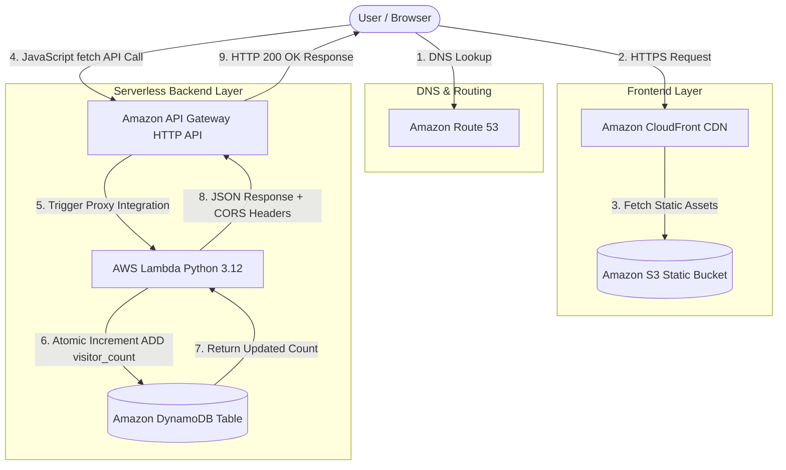

cat << 'EOF' > README.md
# AWS Cloud Resume Challenge

## Project Overview
This repository contains the source code and infrastructure for my serverless Cloud Resume, deployed on AWS.

## 🏗️ Architecture Diagram

## Day 1: Local Setup & Frontend Baseline
* **Local Environment:** Set up project directory structure and initialized local Git version control.
* **Frontend Markup:** Built a responsive single-page HTML resume showcasing technical skills, certifications, and experience.
* **Dynamic Counter UI:** Designed the frontend counter component to display visitor statistics.
* **Version Control:** Connected local workspace to a remote GitHub repository to track project changes.

## Day 2: AWS S3 Static Website Hosting
* **Bucket Provisioning:** Provisioned a dedicated S3 bucket in the Tokyo region (`ap-northeast-1`).
* **Hosting Configuration:** Enabled S3 Static Website Hosting configured to serve the resume site.
* **Access Control:** Configured bucket policies and permissions to allow public web access.
* **Deployment Verification:** Successfully verified the public HTTP website endpoint in the browser.

## Day 3: CloudFront Distribution & HTTPS Enforcement
* **Global Distribution:** Provisioned a CloudFront CDN distribution connected to the S3 bucket origin.
* **Edge Caching:** Enabled global edge caching to deliver static site assets with low latency.
* **Transport Security:** Configured viewer protocol policies to automatically enforce HTTPS encryption across all web traffic.

## Day 4: Custom Domain, TLS Certificate & OAC Security Lockdown
* **Custom Domain Delegation:** Configured custom domain management (`kiran-cloud.com`) by pointing nameservers to an AWS Route 53 Hosted Zone.
* **TLS Certificate Provisioning:** Issued and validated a wildcard SSL/TLS certificate via AWS Certificate Manager (ACM) using DNS validation.
* **S3 Origin Migration & OAC Lockdown:** Secured the S3 bucket by restricting direct public access and configuring CloudFront Origin Access Control (OAC).
* **Edge Routing & Invalidation:** Linked Route 53 Alias records to CloudFront and ran a cache invalidation to verify custom domain HTTPS access.

## Day 5: Database Setup (DynamoDB)
* **Table Provisioning:** Created an on-demand DynamoDB table (`cloud-resume-stats`) with an `id` primary key.
* **Item Initialization:** Seeded the initial database record with a `visitor_count` attribute set to `0`.

## Day 6: Serverless Backend & IAM Least Privilege
* **Python Lambda Function:** Developed a Python Lambda function using Boto3 to increment and retrieve the visitor count from DynamoDB.
* **CORS & JSON Handling:** Configured response headers for CORS support and handled decimal data serialization for API compatibility.
* **IAM Security Enforcement:** Created a least-privilege IAM policy granting Lambda execution permissions exclusively for the target DynamoDB table.

## Day 7: API Gateway & CORS Integration
* **HTTP API Endpoint:** Created an AWS API Gateway (HTTP API) route to trigger the backend Lambda function.
* **CORS Configuration:** Configured Cross-Origin Resource Sharing (CORS) rules to safely allow API requests from the frontend domain.
* **End-to-End Verification:** Tested the public API endpoint via cURL and verified real-time visitor count updates in DynamoDB.

## Day 8: Frontend JavaScript Integration & Full-Stack Hookup
* **Asynchronous Fetch Implementation:** Added an `async/await` JavaScript function to `index.html` to fetch data from the API Gateway endpoint.
* **DOM Dynamics & Error Handling:** Configured live DOM updates for the visitor counter element with fallback error handling.
* **Global Edge Invalidation:** Uploaded updated static assets to S3 and cleared CloudFront cache to verify live full-stack updates.

## Day 9: Python Unit Testing & Test Automation
* **Mocking Strategy:** Used `unittest.mock` to isolate the `boto3` DynamoDB resource and test Lambda logic without calling live AWS services.
* **Test Coverage:** Created `pytest` test cases covering successful database updates (`200 OK`) and backend error handling (`500 Error`).
* **Assertions:** Verified response structure, CORS headers, JSON serialization, and correct parameter formatting for database operations.

## Day 10: GitHub Source Control & Repository Structuring
* **Monorepo Architecture:** Structured the repository into `/frontend` (HTML/CSS) and `/backend` (Python Lambda & Pytest) directories.
* **Ignored Artifacts:** Configured `.gitignore` to exclude bytecode (`__pycache__`), test caches (`.pytest_cache`), and local configs.
* **Version Control:** Initialized Git, set the default branch to `main`, and published the organized repository to GitHub.

## Day 11: Architecture Diagramming & Production Documentation
* **Mermaid.js Integration:** Visualized the complete serverless architecture using declarative Mermaid.js syntax inside GitHub Markdown.
* **Component Mapping:** Defined system components for DNS routing, frontend edge delivery, and serverless backend processing.
* **Data Flow Tracing:** Documented the end-to-end request lifecycle from initial browser load to backend database updates.
* **Documentation Finalization:** Updated `README.md` with testing steps, folder structure breakdowns, and technology stack specifications.

## Day 12: End-to-End Verification, CloudWatch Auditing & Final Production Polish
* **Integration Verification:** Executed live end-to-end testing across all stack layers, confirming successful 200 OK HTTP responses.
* **CORS & Payload Audit:** Checked browser DevTools network calls to confirm API Gateway handles cross-origin headers without edge-case errors.
* **Observability Check:** Inspected AWS CloudWatch Lambda log streams to verify clean function execution, minimal latency, and zero runtime errors.
* **Production Polish & Invalidation:** Refined UI metadata, deployed final assets to S3, and issued a CloudFront cache invalidation to sync changes globally.

## Phase 2: Infrastructure as Code (Terraform Migration)

## Day 13: Toolchain Setup, Remote State Provisioning & S3 Backend Migration
* **Toolchain & Identity Verification:** Configured AWS CLI access in `ap-northeast-1` and verified programmatic credentials using `aws sts get-caller-identity`.
* **Modular Structure Init:** Created the `/terraform` directory with dedicated module folders and configured provider versions.
* **State Infrastructure Provisioning:** Created an encrypted S3 bucket for remote state storage and a DynamoDB table for state locking.
* **Backend State Migration:** Configured the remote S3 backend in Terraform and executed `terraform init` to migrate state off the local machine.

## Day 14: Serverless Backend Module Provisioning & IAM Debugging
* **Schema & IAM Definition:** Defined the DynamoDB table in Terraform and created least-privilege IAM execution roles for Lambda.
* **Lambda Packaging & Environment:** Automated Python code packaging into deployment zip archives and configured environment variables for dynamic table targeting.
* **API Gateway HTTP Stack:** Provisioned API Gateway HTTP routes (`GET /count`), configured CORS settings, and granted Lambda invoke permissions.
* **Resource Adoption & IAM Remediation:** Imported existing AWS resources into Terraform state and fixed IAM policy ARNs to resolve runtime permission errors.

## Day 15: Frontend Module Provisioning, CloudFront OAC & GoDaddy DNS Integration
* **S3 Hosting & Edge Security:** Provisioned private S3 bucket storage with CloudFront Origin Access Control (OAC) policies to restrict direct web access.
* **CloudFront Distribution & SSL:** Deployed a CloudFront distribution linked to custom domain aliases and attached an ACM SSL certificate for HTTPS termination.
* **External DNS Integration (GoDaddy):** Managed DNS records via GoDaddy, configuring root domain routing and a `CNAME` record pointing to CloudFront.
* **State Untangling & Import Remediation:** Imported the existing CloudFront distribution into Terraform state to resolve domain conflict errors and align IaC tracking.
* **Edge Validation & Cache Debugging:** Tested site access using `curl` and `nslookup` to verify end-to-end HTTPS delivery across domain variants.

## Day 16: Infrastructure as Code (Terraform)
* **IaC Framework:** Fully modularized the AWS infrastructure stack using Terraform modules.
* **Resources Managed:** Defined API Gateway, Lambda, DynamoDB, ACM Certificates, and CloudFront distributions in declarative HCL.
* **Troubleshooting & Fixes:** Fixed S3 asset synchronization, corrected API endpoint routing (`/count`), and invalidated edge caches for live updates.
* **CLI Workflow:** Standardized deployment using `terraform init`, `terraform plan`, and `terraform apply` for automated provisioning.
